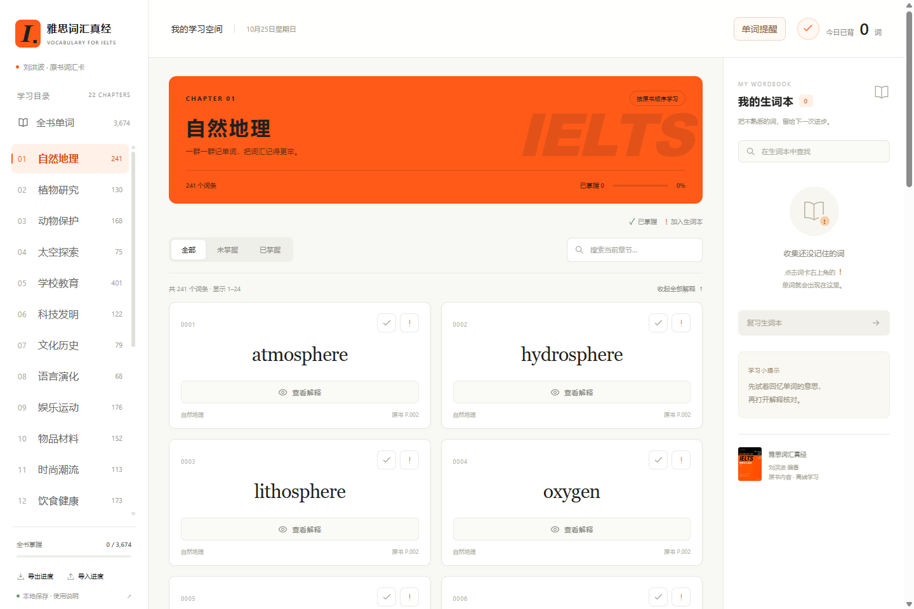
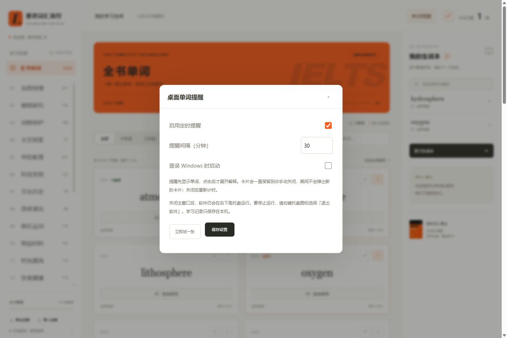
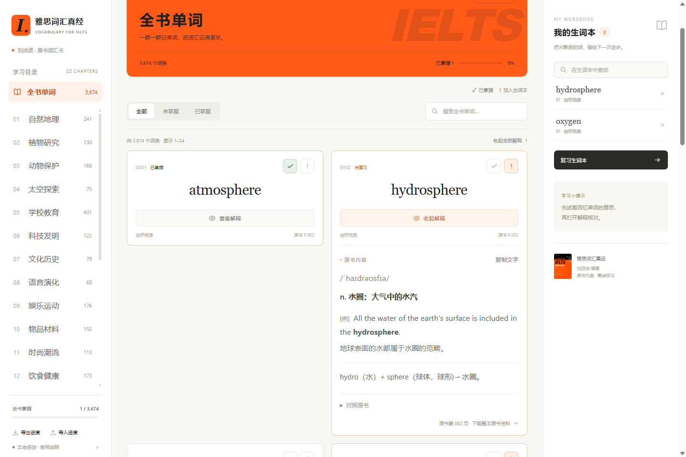
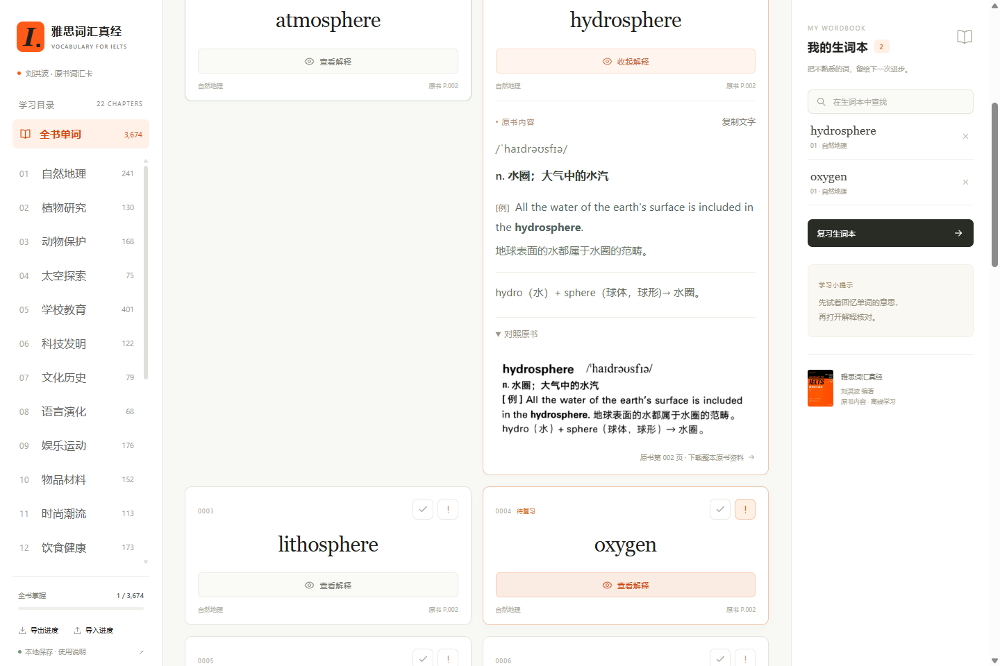

# 《雅思词汇真经》· Liu Hongbo 单词卡

**忙着读论文、写代码，也能利用间隙积累单词。**

基于刘洪波（**Liu Hongbo**）编著《雅思词汇真经》的背词工具：先回忆单词，再展开音标、释义和例句。Windows 桌面版还可以在后台按你设定的间隔弹出单词卡，让复习自然出现在日常工作之间。

**22 个章节 · 3,674 个词条 · 自定义桌面提醒间隔 · 本地保存学习进度**

| 使用方式 | 入口 |
| --- | --- |
| 网页版：电脑、安卓、iPhone / iPad | **[直接打开单词卡](https://wenhao-li111.github.io/ielts-vocabulary-cards/)** |
| Windows 10 / 11，64 位 | [下载 Windows 安装程序 EXE](https://github.com/wenhao-Li111/ielts-vocabulary-cards/releases/latest/download/IELTS-Cards-Setup-1.1.0.exe) |
| Android 8.0 及以上 | [下载 Android 安装包 APK](https://github.com/wenhao-Li111/ielts-vocabulary-cards/releases/latest/download/IELTS-Cards-1.1.0.apk) |
| 全部安装包及版本说明 | [GitHub Releases](https://github.com/wenhao-Li111/ielts-vocabulary-cards/releases/latest) |



*左侧选章节，中间背单词，右侧收集生词；今日已背和全书掌握进度一眼可见。*

## 桌面版亮点：间隔提醒，时间由你设置

不必一直把学习窗口放在眼前。**Windows 版在系统托盘运行时，会按设定间隔持续提醒一个随机单词**：先看英文回忆意思，需要时再展开解释。

<p>
  
  
</p>

| 你关心的事 | 实际使用方式 |
| --- | --- |
| 多久提醒一次？ | 默认 **30 分钟**；在设置界面输入 **1–1440 分钟**的整数，例如 15、30 或 60 分钟。 |
| 在哪里改时间？ | 主界面右上角 **「单词提醒」→「提醒间隔（分钟）」→「保存设置」**。 |
| 关闭主窗口还能提醒吗？ | 可以。软件留在系统托盘运行，定时提醒继续；完全退出软件或关机后停止。 |
| 忙的时候会错过吗？ | 卡片一直保留到手动关闭；未关闭时不叠加新卡，关闭后重新计算下一次间隔。 |
| 能暂停或先试一下吗？ | 可以关闭「启用定时提醒」，也可以点击「立即试一张」。支持自行开启「登录 Windows 时启动」。 |



*修改提醒间隔并保存，就能按自己的学习节奏安排复习。桌面间隔提醒目前仅在 Windows 版提供。*

提醒卡片使用软件自己的置顶小窗口，不会像普通通知横幅那样自动收起。点击「在软件中查看」可打开主窗口并定位该词条；它不会自动关闭提醒卡片。查看提醒里的解释，也会计入桌面版「今日已背」。

## 词库与用法：从一个词开始



1. **选词库范围。** 左侧按 22 个章节学习，或点击「全书单词」检索 3,674 个词条。
2. **先回忆，再揭晓。** 看英文单词，点击「查看解释」，展开音标、释义、例句、搭配等内容；正文可选中复制，也可点击「复制文字」。
3. **留下需要复习的词。** 点击 **✓** 标记已掌握，点击 **!** 加入生词本；右侧可查找、移除生词，或进入「复习生词本」集中复习。
4. **需要时核对资料。** 展开词条里的「对照原书」查看对应扫描图；整本原书资料入口见[资料目录](资料/)。
5. **保存自己的进度。** 学习状态自动保存在本机，可通过左下角「导出进度 / 导入进度」备份或迁移。

<details>
<summary>查看资料对照截图：可复制文字与原书扫描图</summary>



</details>

### 还有这些学习功能

- **按章节学习**：按原书顺序选择章节，也可查找全书词条。
- **回忆后揭晓**：卡片先显示单词，点击「查看解释」平滑展开可复制的正文。
- **掌握与生词本**：✓ 标记掌握，! 加入生词本；可筛选、查找、移除和集中复习。
- **今日已背**：当天查看过解释的不同词条数，同一词条一天只计一次。
- **原书对照**：每条词卡保留对应扫描图，释义、例句、搭配、记忆说明按原书整理。
- **响应式布局**：随可用宽度显示一至三列；手机用顶部按钮打开目录和生词本。
- **本地备份**：导出、导入进度 JSON，手动迁移到另一台设备或另一个版本。
- **Windows 桌面提醒**：默认每 30 分钟随机弹出一张常驻词卡，间隔可在设置中改为 1–1440 分钟，支持暂停。

掌握和生词状态互斥：标记掌握会移出生词本，加入生词本会取消掌握。不同章节的同名单词分别保留、分别记录进度。项目没有账号系统和学习记录服务器。

## 网页版：电脑、安卓和苹果直接用链接

1. 用 Edge、Chrome 或 Safari 打开[网页版](https://wenhao-li111.github.io/ielts-vocabulary-cards/)。不用下载资料、不用安装阅读器。
2. 选择章节、展开词卡开始学习。进度保存在当前浏览器的本地存储中，不上传 GitHub。
3. iPhone / iPad 可在 Safari 中通过「分享 → 添加到主屏幕」建立入口。安卓也可使用浏览器提供的「添加到主屏幕 / 安装应用」入口。
4. 首次需联网加载。核心词库和页面缓存完成后可以离线复习文字；插图和原书扫描图在查看过并缓存后才能离线使用，尚未缓存的图片仍需联网。

GitHub Pages 提供静态文件托管。设备之间不自动同步；网页版、Windows 版、Android 版的存储也互相独立。首次换用另一个版本，先从旧版本导出进度，再在新版本导入。

## Windows EXE 安装与提醒

1. 从上方链接下载 `IELTS-Cards-Setup-1.1.0.exe`，运行后安装到当前 Windows 用户，无需安装 Node.js、Python 或阅读器。
2. 从桌面或开始菜单打开 **《雅思词汇真经》· Liu Hongbo 单词卡**。完整词库和词条图片随软件安装，可断网学习。
3. 右上角「单词提醒」可设置启用 / 暂停、间隔（1–1440 分钟），也可点「立即试一张」。默认 **30 分钟**；开机启动默认关闭，可在设置中自行开启。
4. 到时间后，桌面右下角出现只显示英文单词的卡片。点击单词或「查看解释」才展开原书内容；点击「在软件中查看」会打开主窗口，定位并突出显示同一个词条。
5. 提醒卡片**不设自动消失时间**，手动点 × 才关闭。旧卡片未关闭时不弹出新卡片，也不覆盖旧词；关闭后重新计算间隔，休眠后不会补弹一堆提醒。
6. 关闭主窗口后软件仍留在系统托盘，继续定时提醒。右键托盘图标可打开软件、立即提醒、暂停、改变间隔或完全退出。

常驻提醒使用软件自己的置顶小窗口，避免系统通知横幅自动收起。它不是 Windows 通知中心的常驻项目。点击「在软件中查看」不会替你关闭提醒卡片。查看提醒中的解释也会计入桌面版的「今日已背」。完全退出软件或关机后停止提醒。

Windows 版学习数据保存在当前用户的 `%APPDATA%/IELTSVocabularyCards` 中。安装程序未使用商业代码签名证书；系统可能显示发布者未知。

## Android APK 安装

1. 下载 `IELTS-Cards-1.1.0.apk`，在手机上打开安装。是否允许从当前来源安装，由你在系统提示中决定。
2. 安装后打开 **《雅思词汇真经》· Liu Hongbo 单词卡**，即可直接使用完整离线词库，不需要额外阅读器。
3. 保持 Android System WebView / Chrome 更新。正文、图片、进度均在本机处理，APK 不申请联网权限。
4. 「导出进度」调用系统文件保存器；「导入进度」调用系统文件选择器。卸载前先导出备份，卸载通常会清除应用数据。

APK 为项目自签名发布包；同一签名的后续安装包可覆盖更新。本版本的定时常驻提醒仅在 Windows 版提供。Android 界面适配与运行仍需在具体机型上检验，不承诺所有旧版 WebView 的表现一致。

## 进度保存与迁移

学习记录使用本地 `localStorage`，不随代码提交、不随 GitHub 登录同步，也不会随安装包上传。导入会合并学习记录，同一词条状态以导入备份为准。

请固定使用同一个浏览器 / 应用。隐私模式、清理浏览器数据、卸载应用、换浏览器或更换网址，可能让原来的记录不可见。建议定期导出；电脑浏览器、手机浏览器、主屏幕应用、EXE 和 APK 之间均使用 JSON 导出 / 导入迁移。

## 原书资料与校对

按原书章节、顺序整理音标、释义、英文例句、中文译文、搭配、记忆说明和插图。正文为可复制文字，插图保留图片。文字经过 OCR 转写、双文本逐行比对和疑点回看；普通正文并非每个字都独立目视复核，不能保证零识别错误。详细范围见[校对记录](校对记录.txt)，疑问以词卡里的原书扫描内容为准。

原始 PDF 放在[资料目录](资料/)的无损 ZIP 中，解压得到的 PDF 与原文件字节一致。网页和安装版已内置每条词卡的原图；「下载整本原书资料」会打开 GitHub，需要联网。

仍可使用原来的文件夹版：Code → Download ZIP，完整解压，双击 `开始背单词.html`。若要使用本地「查看原书」跳页，请把 `资料/雅思词汇真经-原书.zip` 中的 PDF 解压到项目根目录，保持文件名不变。原文件夹版的学习记录不会因安装新版本而自动迁移。

## 开发与构建

```text
dist/                       三个平台共用的页面、词库、样式、图片
desktop/                    Electron 主程序、托盘、常驻提醒与安全桥接
android/                    原生 Android WebView 外壳与备份文件选择器
scripts/build-android.ps1   本地构建并签名 APK
scripts/prepare-pages.cjs   准备 GitHub Pages 站点
.github/workflows/pages.yml main 更新后自动部署 Pages
tests/                      提醒计时与暂停等行为测试
资料/                       原书无损压缩包和校验值
```

Windows 开发使用 Node.js 24：`npm ci`，`npm start`。运行 `npm test` 检查提醒逻辑、3,674 条正文渲染和图片完整性；`npm run build:windows` 生成安装程序。`npm run build:pages` 生成 `pages-site/`。

`npm run test:desktop` 会使用独立的临时资料目录，启动桌面版检查真实窗口、提醒展开、跳转和进度保存；结果写入 `tmp/desktop-smoke-result.json`，不会修改日常学习记录。

APK 构建需要 JDK 21、Android SDK Platform 35 和 Build Tools 35.0.0，执行：

```powershell
pwsh -File scripts/build-android.ps1 -JavaHome "你的 JDK 路径" -SdkRoot "你的 Android SDK 路径"
```

APK 签名密钥保存在构建者电脑的 `%LOCALAPPDATA%/IELTSCardsBuild/signing/`，不提交到仓库。请自行安全备份，用相同密钥签名后续更新。构建输出位于 `release/`。

## 许可与来源

这是非官方个人学习项目，与原书作者及出版社无隶属关系。自行编写的网站及应用代码采用 [MIT License](LICENSE)。**MIT 许可不覆盖原书 PDF、转写词条、封面、扫描图和插图**；这些资料的著作权属于原作者及相关权利人，见 [NOTICE.md](NOTICE.md)。
